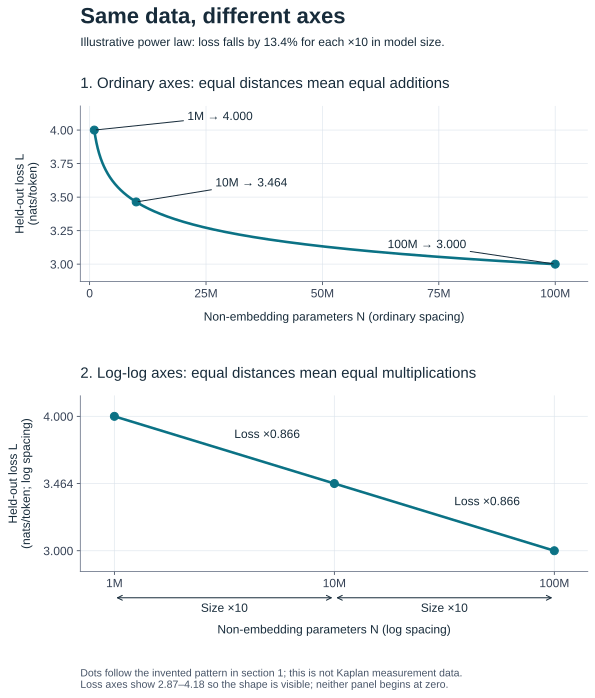

# 10.2 · Kaplan scaling laws; fit a curve

<div class="prereq">
<p><strong>Prerequisites:</strong> parameter counting and the $6ND$ compute rule from <a href="#/lessons/module-10/lesson-01">10.1 · FLOPs & parameter counting</a>; the training loop from <a href="#/lessons/module-07/lesson-01">07.1</a> and <code>get_batch</code> from <a href="#/lessons/module-04/lesson-03">04.3</a>; cross-entropy loss as the training signal from <a href="#/lessons/module-01/lesson-04">01.4</a>. Logarithms and a straight-line fit ($y = mx + b$) — no more than that.</p>
<p><strong>You will learn:</strong> what a <strong>power law</strong> is and why it becomes a straight line on <strong>log-log axes</strong>; the Kaplan et al. 2020 empirical laws $L(N)=(N_c/N)^{\alpha_N}$ (and the analogous laws in data $D$ and compute $C$); and — hands on — how to <strong>fit one</strong>: train several tiny GPTs of increasing size on one toy corpus, record their final loss, and recover the exponent by linear regression in log-log space with <code>fit_power_law</code>.</p>
<p><strong>Why this matters for ML:</strong> scaling laws are how labs <em>predict the future</em>. Fit the power law on cheap small runs, then extrapolate the straight line to say what loss a 100× bigger model will reach — <em>before</em> building it. This is the empirical backbone of every modern pretraining decision, and the tool that makes 10.3's compute-optimal allocation possible.</p>
</div>

## 1. Intuition: what are we trying to predict?

Suppose you can afford to train a few small language models, but you are deciding whether to train a much larger one. **How much better will its predictions be?** A scaling law tries to answer that question from measurements of the small models.

### 1.1 First, understand one dot on the plot

For each model, record two numbers:

- **Model size $N$:** the number of non-embedding parameters, counted as in [10.1](lessons/module-10/lesson-01.md). For example, $N = 10^6$ means one million parameters, written **1M**.
- **Loss $L$:** average cross-entropy on held-out text. Lower is better: the model assigns more probability to the tokens that actually occur. Loss 3.0 is better than loss 4.0; it does **not** mean "3% wrong" or "75% accuracy."

A dot at $(N, L) = (1\text{M}, 4.0)$ therefore means: "We trained a 1M-parameter model and measured held-out loss 4.0." Each dot represents a **separate trained model**, rather than another training step of the same model.

To compare sizes meaningfully, use the same tokenizer and held-out text. Also give each model enough data and training to make model size the main limitation. A larger model stopped too early may perform worse; that would tell us about its training, rather than its potential at that size.

### 1.2 The pattern: multiply size, multiply loss

Imagine the following **made-up example**. The numbers illustrate a power law; they are not measurements from Kaplan's paper. We will use the first and last rows again in section 3.

| Non-embedding parameters $N$ | Held-out loss $L$ | Change from the previous row |
|---|---:|---|
| 1M | 4.000 | Starting point |
| 10M | 3.464 | Size ×10; loss ×0.866 |
| 100M | 3.000 | Size ×10; loss ×0.866 |

The model gets **10 times bigger** on each row. The loss becomes about **86.6% of its previous value**, so each jump reduces loss by about **13.4%**.

Notice what stays constant: the **fractional reduction**, rather than the amount subtracted. The first jump removes about 0.536 loss units; the second removes about 0.464. That is why the improvement slows down in absolute terms even though the proportional rule stays the same. A relationship with this behavior is called a **power law**.

### 1.3 Why change the axes?

On an ordinary axis, equal distances mean equal **additions**: 10M, 20M, 30M. On a logarithmic axis, equal distances mean equal **multiplications**: 1M, 10M, 100M. The latter gives our two ×10 jumps the same amount of horizontal space.

Changing the loss axis to a log scale also gives equal loss ratios equal vertical distances. Now each "size ×10, loss ×0.866" jump moves the same distance right and the same distance down. Repeated identical moves form a straight line.



**Read the figure:** all three dots retain their original model sizes and losses. We have changed their positions on the page, not trained different models or improved their predictions. Both axes must be logarithmic for a power law to become a straight line.

**Publicly documented result:** [Kaplan et al. (2020), Figure 1 and section 1.2](https://arxiv.org/abs/2001.08361), found approximate power laws in held-out language-model loss versus model size, dataset size, and well-allocated training compute. This lesson teaches that historical result and how to fit its mathematical form. The exponents describe their experimental setup; they are not universal constants for every corpus or model.

<div class="callout key"><p>The useful claim is more specific than "bigger models are better": over a suitable range, multiplying a resource by a fixed factor produces an approximately fixed proportional change in loss. That regularity lets us make predictions. It must be checked against data before extrapolating.</p></div>

## 2. Mathematics: turn the proportional rule into a line

### 2.1 The formula, one piece at a time

Start with model size alone:

$$
L(N) = c\,N^{-\alpha_N}.
$$

| Symbol | Meaning | How to read it |
|---|---|---|
| $N > 0$ | Non-embedding parameter count | The resource we increase |
| $L(N) > 0$ | Predicted held-out cross-entropy, in nats/token | The loss we want to decrease |
| $c > 0$ | Fitted coefficient | Sets the vertical level of the curve |
| $\alpha_N > 0$ | Fitted scaling exponent, pronounced "alpha sub N" | Controls how quickly loss falls as size grows |

The parentheses in $L(N)$ mean "loss **as a function of** model size." They do not mean multiply $L$ by $N$.

The negative exponent means **divide by a power of $N$**. For a simple numerical example, choose $c = 8$ and $\alpha_N = 0.5$. Since raising a number to $0.5$ takes its square root:

$$
L(4) = 8\cdot 4^{-0.5} = \frac{8}{\sqrt{4}} = 4,
\qquad
L(16) = \frac{8}{\sqrt{16}} = 2.
$$

In this deliberately simple example, making the resource four times larger halves the loss. These tiny numbers demonstrate the arithmetic, not realistic language-model sizes.

### 2.2 What the exponent tells you

Let $k > 1$ be the factor by which we grow the model: $k = 10$ means ten times as many parameters. Divide the prediction at the larger size by the prediction at the starting size:

$$
\frac{L(kN)}{L(N)}
= \frac{c\,(kN)^{-\alpha_N}}{c\,N^{-\alpha_N}}
= k^{-\alpha_N}.
$$

The coefficient and starting size cancel. **The loss ratio depends only on the size multiplier and the exponent.**

For example, with $k = 10$ and $\alpha_N = 0.06247$, the multiplier is $10^{-0.06247} \approx 0.866$. Starting from loss 4.0 gives $4.0\times 0.866 \approx 3.464$; starting from 3.464 gives approximately 3.0. This recovers the pattern in section 1.

A larger positive exponent means faster improvement. With the same ×10 size increase, $\alpha_N = 0.1$ gives a loss multiplier of about 0.794, while $\alpha_N = 0.5$ gives about 0.316. **An exponent of 0.1 does not mean a 10% loss reduction**: the reduction also depends on how much you grow the resource.

### 2.3 Kaplan's notation: the same curve written another way

Kaplan writes the model-size law as:

$$
L(N) = \left(\frac{N_c}{N}\right)^{\alpha_N}
= N_c^{\alpha_N}\,N^{-\alpha_N}.
$$

$N_c$ ("N sub c") is a fitted scale with the same units as $N$, not the size of the model you are training. The right-hand side shows that this is the same formula as before, with $c = N_c^{\alpha_N}$.

For a numerical check, let $N_c = 64$ and $\alpha_N = 0.5$. Then $c = \sqrt{64} = 8$, and at $N = 4$ both forms give $L(4) = \sqrt{64/4} = 8/\sqrt{4} = 4$. Substituting $N = N_c = 64$ gives loss 1. That is the meaning of this scale parameter, even when it lies far outside the fitted range.

The analogous laws for dataset size and compute are:

$$
L(D) = \left(\frac{D_c}{D}\right)^{\alpha_D},
\qquad
L(C) = \left(\frac{C_c}{C}\right)^{\alpha_C}.
$$

Here $D$ is **dataset size in tokens**; $D_c$ is its fitted scale; and $\alpha_D$ is its exponent. $C$ is **training compute**, measured in FLOPs here; $C_c$ uses the same compute unit; and $\alpha_C$ is its exponent. Lowercase $c$, the coefficient in our fitting function, is different from uppercase $C$, the compute budget.

As an arithmetic example, if $D_c/D = 100$ and $\alpha_D = 0.1$, the data law predicts loss $100^{0.1} \approx 1.585$. If $C_c/C = 100$ and $\alpha_C = 0.05$, the compute law predicts $100^{0.05} \approx 1.259$. These chosen numbers illustrate how to evaluate each formula; they are not reported measurements.

These are **different experimental relationships**, not three terms to add together:

- For $L(N)$, provide enough data and training that model capacity is the main limitation.
- For $L(D)$, use a sufficiently large model and select training duration to avoid overfitting the limited dataset.
- For $L(C)$, use sufficient data and choose the model size and training allocation well. Giving an arbitrary model extra FLOPs does not automatically place it on this curve.

The paper denotes the compute-efficient case by $C_{\min}$; we use $C$ as shorthand here. It reports $\alpha_N \approx 0.076$ for its model-size fit. For perspective, doubling size then predicts a loss multiplier $2^{-0.076} \approx 0.949$, about a 5.1% decrease. See [Kaplan et al., equations 1.1–1.3](https://arxiv.org/pdf/2001.08361). The lesson's FLOP estimate from 10.1 counts **processed training tokens**, which can include repeated passes; that count differs from dataset size $D$ when tokens are reused.

### 2.4 Logs translate multiplication into addition

We will use base-10 logarithms. $\log_{10} a$ asks: **"10 raised to what power equals $a$?"** For example, $\log_{10}(10^6) = 6$ and $\log_{10}(10^8) = 8$. The increase from 1M to 100M becomes a horizontal change of $8 - 6 = 2$: two successive ×10 increases.

Two log rules do the work:

$$
\log_{10}(ab) = \log_{10} a + \log_{10} b,
\qquad
\log_{10}(a^r) = r\log_{10} a.
$$

Here $a,b > 0$ are numbers and $r$ is an exponent. For example, $\log_{10}(10\times 100) = 3 = 1 + 2$, and $\log_{10}(100^{-0.5}) = \log_{10}(0.1) = -1 = -0.5\times 2$.

Apply those rules to the power law:

$$
\begin{aligned}
\log_{10} L
&= \log_{10}\left(c\,N^{-\alpha_N}\right) \\
&= \log_{10} c + \log_{10}\left(N^{-\alpha_N}\right) \\
&= \log_{10} c - \alpha_N\log_{10} N.
\end{aligned}
$$

Now compare it with the familiar equation of a line, $Y = mX + b$:

| Line quantity | In the scaling-law fit | Example from sections 1 and 3 |
|---|---|---|
| Horizontal coordinate $X$ | $\log_{10} N$ | A 1M model has $X = 6$ |
| Vertical coordinate $Y$ | $\log_{10} L$ | Loss 4.0 has $Y \approx 0.60206$ |
| Slope $m$ | $-\alpha_N$ | About $-0.06247$ |
| Intercept $b$ | $\log_{10} c$ | About $0.97688$ |

For a concrete substitution, $Y = -0.06247\times 6 + 0.97688 \approx 0.60206$. Converting back gives $L = 10^{0.60206} \approx 4.0$.

This is why fitting a power law can be simple: **take logs of the positive measurements, fit a straight line, then translate its slope and intercept back.** Natural logs give the same exponent; section 4 uses `np.log` and reverses it with `np.exp`.

<div class="callout"><p>Keep the sign straight: the plotted line slopes downward, so $m$ is negative. The scaling exponent is $\alpha_N = -m$, so it is positive. The intercept controls the level of the line; the exponent controls its rate of decline.</p></div>

## 3. Numerical example: fit the curve and use it to predict

We now have only **two hypothetical measurements**:

| Quantity | Small model | Large model |
|---|---:|---:|
| Parameters $N$ | $10^6$ (1M) | $10^8$ (100M) |
| Measured loss $L$ | 4.0 | 3.0 |
| $X = \log_{10} N$ | 6 | 8 |
| $Y = \log_{10} L$ | 0.60206 | 0.47712 |

The unknowns are the exponent $\alpha_N$ and coefficient $c$. We will find the exponent first, anchor the curve to the small model, and then recover the coefficient used by the code in section 4. A calculator with `log10` is enough to follow along.

### 3.1 Find the slope: change in log loss divided by change in log size

Slope is "vertical change divided by horizontal change." The subscripts 1 and 2 below label the small and large measurements:

$$
m = \frac{Y_2 - Y_1}{X_2 - X_1}
= \frac{0.47712 - 0.60206}{8 - 6}
= \frac{-0.12494}{2}
\approx -0.06247.
$$

The horizontal change is **2**, not 100: the size ratio is 100, but the difference between its logs is $\log_{10}(100) = 2$. The vertical change is negative because loss improved.


Since $m = -\alpha_N$, we obtain **$\alpha_N \approx 0.06247$**. That means each ×10 increase in size multiplies predicted loss by $10^{-0.06247} \approx 0.866$.

### 3.2 Predict relative to a model we already measured

We do not need $c$ yet. Use the small model as an anchor:

$$
L(N) = 4.0\left(\frac{N}{10^6}\right)^{-0.06247}.
$$

Everything is easy to read: start at loss **4.0**, divide the target size by **1M** to get the size multiplier, then raise that multiplier to the negative exponent.

At 10M parameters, the size multiplier is 10:

$$
L(10^7) = 4.0\times 10^{-0.06247}
\approx 4.0\times 0.86603
\approx 3.464.
$$

This fills in the middle row from section 1. It is **interpolation**: a prediction between the two measured sizes. It is a prediction to test, not an additional measurement.

Check the large model, where the size multiplier is 100:

$$
L(10^8) = 4.0\times 100^{-0.06247}
\approx 4.0\times 0.75000
= 3.0.
$$

That agrees with the second measurement, as it must for a line fitted through exactly two points.

### 3.3 Recover the coefficient that `fit_power_law` returns

Section 4's function returns the unanchored form $L(N) = c\,N^{-\alpha_N}$. Substitute the small model and solve for $c$:

$$
\begin{aligned}
4.0 &= c\,(10^6)^{-0.06247}, \\
c &= 4.0\,(10^6)^{0.06247} \\
  &= 4.0\times 10^{0.37482} \\
  &\approx 9.4815.
\end{aligned}
$$

So the same fitted curve is:

$$
L(N) \approx 9.4815\,N^{-0.06247}.
$$

Here $N$ must be the **raw parameter count**: use `1e6`, not `1` to mean "one million." Changing the unit changes the coefficient, although it leaves the exponent unchanged. The anchored form avoids this trap because $N/10^6$ explicitly states the size ratio.

The code call `fit_power_law([1e6, 1e8], [4.0, 3.0])` returns approximately `(0.06247, 9.4815)`: **exponent first, coefficient second**. In the line form, the intercept is $b = \log_{10}(9.4815) \approx 0.97688$, matching section 2.4. Small discrepancies in the last digits come from rounding; the code uses full precision.

### 3.4 Try one prediction beyond the measurements

**Practice — about 2 minutes, calculator only.** Before opening the worked calculation, predict the loss at **1B parameters**. Start from the measured 100M model with loss 3.0 and make one more ×10 size jump. Your result should be below 3.0 but nowhere near zero.

<details><summary>Hint</summary>

The size multiplier is 10, so multiply loss 3.0 by $10^{-0.06247}$.

</details>

<details><summary>Worked calculation</summary>

$$
L(10^9) = 3.0\times 10^{-0.06247}
\approx 3.0\times 0.86603
\approx 2.598.
$$

Using the small-model anchor gives the same answer: $4.0\times 1000^{-0.06247} \approx 2.598$.

</details>

This is **extrapolation**: 1B lies beyond the largest measured model, 100M. The number is what the fitted formula predicts, not a guarantee of what a new training run will achieve. We must check that the training setup remains comparable and that the curve has not started flattening toward the data's irreducible loss, discussed in section 6.

Two points always define a straight line in log space. They cannot establish that a power law is a good model of the real relationship. With several measurements, look for an approximately straight pattern and fit a line through the scatter; that is what the implementation does next.

*Source check: the Kaplan notation and experimental conditions above were checked against the original 2020 paper on 2026-10-14. The example values and diagrams are illustrative, rather than reproductions of the paper's measurements.*

## 4. From scratch: `fit_power_law` via log-log least squares

The fit is short — take logs, run a degree-1 least-squares polynomial fit, negate the slope:

```python
import numpy as np

def fit_power_law(x, y):
    """Fit y = coefficient * x**(-exponent) by least squares in log-log space."""
    x = np.asarray(x, dtype=np.float64)
    y = np.asarray(y, dtype=np.float64)
    log_x, log_y = np.log(x), np.log(y)
    slope, intercept = np.polyfit(log_x, log_y, deg=1)   # log_y = slope*log_x + intercept
    exponent = -float(slope)          # slope is -alpha in the decay convention
    coefficient = float(np.exp(intercept))
    return exponent, coefficient
```

Two design points worth stating explicitly. First, we fit in **log space, not linear space**: minimising squared error on $\log L$ treats a 10% error at loss 5 the same as a 10% error at loss 2, which is what you want for a multiplicative law — a linear-space fit would let the large-loss points dominate. Second, we **negate the slope** so a decaying law (loss falls as $x$ grows) reports a *positive* exponent, matching the $(N_c/N)^{\alpha}$ convention. This is the version in `llmre.evaluation.scaling`; its docstring states the exact model it fits.

## 5. Fit a real curve: a tiny GPT sweep

Now the hands-on part the brief asks for: fit a scaling law on models you actually train. The script `code/experiments/scaling_sweep.py` trains six tiny GPTs of increasing width (`n_embd` from 8 to 64, two layers each) on one fixed toy corpus, records each model's final loss, and calls `fit_power_law`. The core loop:

```python
from llmre.model.config import GPTConfig
from llmre.model.gpt import GPT
from llmre.data.loader import get_batch
from llmre.evaluation.scaling import fit_power_law

Ns, Ls = [], []
for w in [8, 16, 24, 32, 48, 64]:
    cfg = GPTConfig(vocab_size=256, block_size=32, n_layer=2, n_head=4, n_embd=w)
    model = GPT(cfg)
    opt = torch.optim.AdamW(model.parameters(), lr=3e-3, betas=(0.9, 0.95))
    for _ in range(600):                       # a few hundred steps is plenty for a toy
        x, y = get_batch(data, 32, 32)
        _, loss = model(x, y)
        opt.zero_grad(set_to_none=True); loss.backward(); opt.step()
    Ns.append(model.num_params(non_embedding=True))
    Ls.append(final_loss(model, data))         # mean loss over a few held-out batches

exponent, coefficient = fit_power_law(Ns, Ls)
```

Running it (seeded, ~1–2 minutes on a laptop CPU) produces a table like this and the fit below it:

```
 n_embd   N (non-emb)  final loss
      8         1,536      2.6931
     16         6,144      2.4489
     24        13,824      2.2707
     32        24,576      2.1435
     48        55,296      1.9017
     64        98,304      1.7331

fitted power law:  L(N) = 4.86 * N**(-0.0700)
fitted exponent alpha_N = 0.0700
```

Loss falls monotonically as width grows, and the six points lie close to a log-log straight line — a real, if tiny, scaling law fitted from scratch. The fitted exponent (**$\alpha_N \approx 0.07$** on this toy setup) happens to land near Kaplan's reported $\alpha_N \approx 0.076$, but do not read anything into that coincidence: six 100k-parameter models on a repeated toy corpus cannot estimate the real exponent. What the sweep *does* show honestly is the mechanism — bigger model, lower loss, straight in log-log — and that `fit_power_law` recovers a sensible slope from real training runs.

<div class="callout warn"><p>A toy sweep like this is a <em>demonstration</em>, not a measurement of "the" scaling exponent. Real scaling studies span many orders of magnitude of $N$, use a real corpus large enough that data is never the bottleneck, tune each run's learning-rate schedule to its size, and average over seeds. The exponent from six tiny models on a 5-sentence corpus is qualitative only.</p></div>

## 6. Under the hood: least squares, and what the fit assumes

`np.polyfit(log_x, log_y, 1)` solves a tiny linear least-squares problem: find slope $m$ and intercept $b$ minimising $\sum_i (\,b + m\log x_i - \log y_i\,)^2$. That has the closed-form normal-equations solution (module 2's linear algebra), which is why the fit is instant and has no hyperparameters. The fit *assumes* the log-log relationship really is linear — that a single power law holds over the range you measured. That assumption is what Kaplan verified empirically and what can break: near the **irreducible loss** (the entropy of the data itself, below which no model can go — the $E$ term of 10.3) the curve flattens and bends *away* from the straight line, so extrapolating a pure power law too far predicts impossibly low loss. A good fit reports the range it was fit over and does not extrapolate past where the line stays straight.

## Research connection

<div class="callout paper"><p><strong>Scaling Laws for Neural Language Models</strong> (Kaplan et al., 2020) — <a href="#/papers/index">paper #3 in the reading list</a>. This is the paper you have just reproduced in miniature. <strong>Read:</strong> the abstract, the main power-law figure (loss vs $N$, $D$, $C$ as straight log-log lines), and equation set for $L(N), L(D), L(C)$. <strong>What to understand:</strong> loss follows power laws over many orders of magnitude; larger models are more sample-efficient; how they split a compute budget between $N$ and $D$. <strong>Skip on a first pass:</strong> the batch-size critical-value derivations and the detailed fitting-methodology appendices. Note the conclusion about compute allocation — Kaplan favours spending most of extra compute on <em>bigger models</em>. Lesson 10.3 (Chinchilla) revises exactly that conclusion, so hold it loosely.</p></div>

## Exercise

A sweep of three models gives: $N = 10^6 \to L = 3.60$; $N = 10^7 \to L = 3.00$; $N = 10^8 \to L = 2.50$. **(a)** Using the first and last points, estimate $\alpha_N$ by the two-point log-log slope. **(b)** Predict the loss of a $10^9$-parameter model by extrapolating the line. **(c)** Why should you distrust that prediction?

<details><summary>Hint</summary>
(a) slope $= (\log_{10}L_{\text{last}} - \log_{10}L_{\text{first}})/(\log_{10}N_{\text{last}} - \log_{10}N_{\text{first}})$, then $\alpha_N = -\text{slope}$. (b) each 10× in $N$ multiplies $L$ by $10^{-\alpha_N}$; you are going one more decade. (c) think about the irreducible loss.
</details>

<details><summary>Stronger hint</summary>
(a) $(\log_{10} 2.50 - \log_{10} 3.60)/(8 - 6)$. (b) $L(10^9) = L(10^8)\cdot 10^{-\alpha_N}$. (c) a pure power law predicts loss $\to 0$ as $N\to\infty$, but text has nonzero entropy.
</details>

<details><summary>Solution</summary>

**(a)** $\log_{10} 2.50 = 0.3979$, $\log_{10} 3.60 = 0.5563$. Slope $= (0.3979 - 0.5563)/(8 - 6) = -0.1584/2 = -0.0792$, so $\alpha_N \approx 0.079$.

**(b)** Going from $10^8$ to $10^9$ is one more decade, multiplying loss by $10^{-0.0792} = 0.833$. So $L(10^9) \approx 2.50 \cdot 0.833 \approx 2.08$. (`fit_power_law` on all three points gives a very similar slope, since they are near-collinear in log-log.)

**(c)** The pure power law implies loss keeps falling toward $0$ forever, but language has an **irreducible entropy** $E > 0$ that no model can beat. As $N$ grows the true curve flattens toward $E$ and bends below the straight line, so a single-power-law extrapolation over-predicts the gains. This is precisely why Chinchilla (10.3) fits $L(N,D) = E + A/N^\alpha + B/D^\beta$ with an explicit floor $E$, instead of a bare power law.

</details>

## Common mistakes

- **Fitting in linear space.** Fit the *logs*; a linear-space least-squares fit lets the large-loss points dominate and distorts the exponent.
- **Reading the sign wrong.** In log-log the slope is $-\alpha$; a decaying loss has a *negative* slope and a *positive* exponent. `fit_power_law` negates for you — know that it does.
- **Extrapolating past the straight part.** Near the irreducible loss the line bends; extrapolating a pure power law there predicts impossibly low loss.
- **Treating a toy exponent as "the" exponent.** Six tiny models on a toy corpus estimate the *mechanism*, not the real $\alpha_N$.

## Check yourself

<details><summary>Why does a power law $L = c\,x^{-\alpha}$ become a straight line on log-log axes, and what are the line's slope and intercept?</summary>

Taking logs: $\log L = \log c - \alpha \log x$. With $\log x$ on the horizontal axis and $\log L$ on the vertical, this is $y = (-\alpha)X + \log c$ — a line of slope $-\alpha$ and intercept $\log c$.

</details>

<details><summary>A fit returns exponent $0.05$ and coefficient $8.0$. What loss does it predict at $N = 10^7$?</summary>

$L = 8.0 \cdot (10^7)^{-0.05} = 8.0 \cdot 10^{-0.35} = 8.0 \cdot 0.4467 \approx 3.57$.

</details>

<details><summary>You fit $\alpha_N = 0.076$. Roughly how much must you scale $N$ to halve the loss (ignoring the irreducible floor)?</summary>

Halving loss needs $x^{-\alpha_N} = 0.5$, i.e. $x = 0.5^{-1/0.076} = 2^{1/0.076} = 2^{13.2} \approx 9400$. You must grow $N$ by roughly four orders of magnitude to halve the loss — the brutal economics of scaling, and why exponents this small make frontier training so expensive.

</details>

<details><summary>Your six-point sweep bends downward at the largest model instead of staying straight. What might be happening?</summary>

Two common causes: (1) the largest model is starting to hit the irreducible loss / overfit the tiny corpus, so the curve flattens; or (2) the larger models are under-trained or mistuned (same step count and LR for every size), so their measured loss is artificially high or low. Either way the single-power-law fit is no longer valid over the whole range — refit only over the straight portion, or fix the training.

</details>

<div class="hw">
<p><strong>Hardware track — the toy sweep.</strong></p>
<p><strong>Minimum:</strong> any laptop CPU. The six models are ~1k–100k parameters each; the whole sweep of 6 × 600 steps runs in roughly 1–2 minutes on CPU, no GPU required. <strong>Recommended:</strong> same — a GPU is pointless at this size (kernel-launch overhead dominates). <strong>GPU memory:</strong> negligible (<50 MB). <strong>GPU-hours:</strong> 0. <strong>CPU-only:</strong> yes, this is designed for it. A <em>real</em> scaling study is the opposite extreme — dozens of runs from millions to billions of parameters, many GPU-days each; that is a cluster job, not a lesson exercise, which is exactly why we fit the mechanism on a toy.</p>
</div>

## Next

You can now fit a scaling law and read its exponent. But Kaplan's laws describe $L(N)$ and $L(D)$ *separately*; the real planning question couples them: given a fixed compute budget $C = 6ND$, how do you split it between model size and tokens to get the lowest loss? Chinchilla answers that with a single fit $L(N, D)$ and a constrained optimisation — and overturns Kaplan's "spend it on bigger models" conclusion.

Continue to [10.3 · Chinchilla compute-optimality](lessons/module-10/lesson-03.md).
